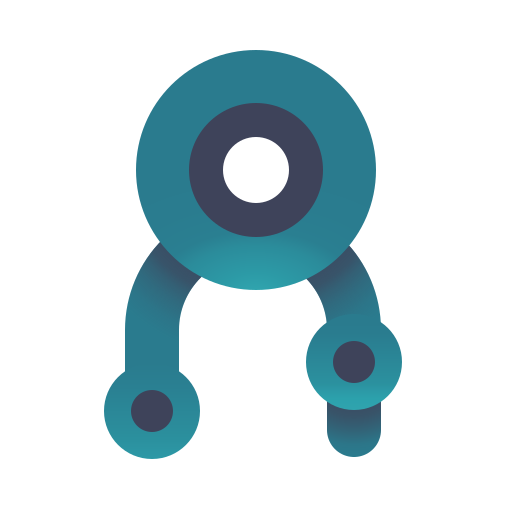

<p align="center">
  
</p>

<h1 align="center">RitKraken</h1>

<p align="center">
  A fast desktop Git client written in Rust, powered by <a href="https://github.com/longbridge/gpui-kit">GPUI Kit</a> and your local Git CLI.
</p>

## User Requirements & Notes

- **Git 2.37 or newer** must be installed and available on your `PATH`. RitKraken delegates all repository reads and writes to the system `git` executable.
- **macOS 15 or newer** is required to run the macOS application.
- **Preview limits**: File and diff previews are capped at 8 MiB. Hunk and single-line staging apply to modified text files; added, deleted, renamed, and binary files can be staged as a whole.
- **Automatic fetching**: Set its timeout in seconds under **Preferences → Git** (default: 30). A timed-out attempt is cancelled; automatic fetching resumes on the next scheduled interval.
- **Settings**: Language (`English`, `简体中文`, `繁體中文`, `日本語`) and color themes (`Nawal`, `One Dark Pro`, `Dracula`, `Nord`, `RitKraken Classic`, `Catppuccin Latte`) can be switched in **Preferences** (`Ctrl+,` / `Cmd+,`) and take effect immediately.

## Developer Requirements & Notes

- **Rust 1.92 or newer** is required to build from source.
- **Windows**: Requires the MSVC Rust toolchain, Visual Studio C++ Build Tools, and the Windows SDK. Close a running `ritkraken.exe` before rebuilding so the executable is not locked.
- **macOS**: Requires Xcode Command Line Tools (`xcode-select --install`). The generated `.app` bundle uses ad hoc signing for local use.
- **Python 3.11 or newer** is required to run the project checks.

## Building

Run the build script for your platform from the repository root:

| Platform | Command | Output |
| --- | --- | --- |
| Windows | `.\build-windows.cmd` | `target/windows/<target>/release/ritkraken.exe` |
| macOS | `bash ./build-macos.sh` | `target/macos/<target>/release/RitKraken.app` |

You can also launch a repository directly via `cargo run --release` with `--target`, `--target-dir`, and `-- <repo-path>`.

## Testing & Checks

```powershell
# Windows (x64)
cargo test --workspace --release --locked --target x86_64-pc-windows-msvc --target-dir target/windows
python tools/check_project.py
```

```bash
# macOS
cargo test --workspace --release --locked --target "$(rustc -vV | sed -n 's/^host: //p')" --target-dir target/macos
python3 tools/check_project.py
```

`tools/check_project.py` (Python 3.11+) enforces the 1,000-line limit across all tracked/unignored files, including `Cargo.lock`.

## Project Layout

- `crates/git`: Git operations, history, worktree, diffing, and remotes (independent of GPUI).
- `crates/diff`: Patched GPUI Diff renderer with split-view layout, hunk/line controls, edge-whitespace filtering, and change overview markers.
- `crates/desktop`: Desktop UI, themes, session tabs, commit graph, file review, and preferences.
